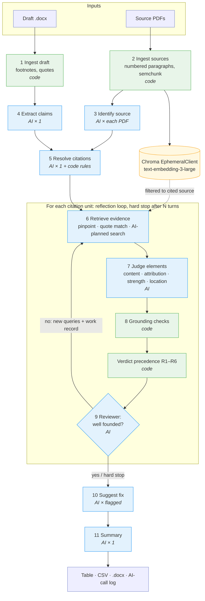

# Footnote–Source Verifier

**LAWS90286 Assignment 2 · Streamlit application**

**Deployed app:** https://laws90286-footnote-verifier.streamlit.app

**To use it:** enter the app password (supplied with the assignment submission), then your own OpenAI API key in the sidebar (**API Key Input** → **Update API Key**).

Upload a draft legal research paper (.docx with real Word footnotes) and PDFs of the cases it cites. For every footnote, the app checks whether the cited source, **at the cited pinpoint**, actually supports the proposition, and reports a verdict, the supporting passage, who in the judgment is speaking, and a suggested fix.

---

## 1. Purpose and legal rationale

Accurate citation is a professional and academic obligation: a footnote is a representation that the source says what the text says it says. Common errors include:

- **overstated holdings**: "may" becomes "must", a discretionary consideration becomes a rule, obiter becomes a holding;
- **misattribution**: words the appellate court *quotes from the trial judge*, or summarises from counsel, presented as the court's own holding;
- **wrong pinpoints**; and
- **fabricated or altered quotations**, which generative AI makes increasingly easy to introduce.

The app reproduces the check a careful editor or supervising lawyer makes of each footnote. The design principle is that **work the computer can do exactly is done in code**: finding a quotation in the source, reading a pinpoint, resolving *Ibid* and *(n X)*. **Judgement is done by the AI**: who is speaking, and how strong a statement is. The AI's judgement is then checked by code and by a second AI reviewer. Where code can establish a fact (for example, a quotation is not in the source), **the code wins over the AI**.

## 2. The task broken into steps

| # | Step | How | AI calls |
|---|---|---|---|
| 1 | **Ingest the draft**: body text with footnote markers; footnote texts; quoted phrases | `zipfile` + `lxml` on `word/document.xml` and `word/footnotes.xml` (python-docx cannot read footnotes). Footnotes are numbered by order of appearance, as the reader sees them; separators (ids −1/0) are ignored. | 0 |
| 2 | **Ingest sources**: PDF → paragraph-numbered segments | `pypdf` *layout* mode; boilerplate stripped (Jade footer, CanLII header/watermark); `111.` and `[42]` numbering, accepting only numbers that continue the running sequence; longest 1..N chain wins (handles Kapua's headnote restart). Paragraphs over 400 tokens are sub-chunked with **semchunk**, keeping the paragraph number and character offsets. Scanned PDFs are flagged as unreadable. | 0 |
| 3 | **Identify each source**: case, citation(s), court, date, numbering style | Strict JSON. Copies only what is printed; never adds a citation from memory. Shown to the user to check. | 1 per PDF |
| 4 | **Extract claims**: the proposition behind each footnote, who the draft attributes it to, quoted phrases, the author's own commentary | Strict JSON. Quoted phrases are verified *verbatim against the draft* in code and merged with a deterministic regex extraction. | 1 |
| 5 | **Resolve citations**: split multi-source footnotes; resolve *Ibid*, *(n X)*, short titles, parallel citations; parse pinpoints; match to an uploaded file or NOT_PROVIDED | Code annotates *Ibid*/(n X) → one AI call (the match is an **enum** of uploaded file ids, so it cannot invent one) → code **enforces** the AGLC rules, an exact medium-neutral-citation match, a **party-name guard** and a pinpoint cross-check. | 1 |
| 6 | **Retrieve evidence** per citation unit | (a) pinpoint fetch: whole cited paragraphs ±1; (b) exact-quote match: paragraphs containing the draft's quotations; (c) AI-planned queries (Lab 2 `_plan_queries`) → Chroma search **filtered to the cited source only**. | 1 per unit per turn |
| 7 | **Judge** | Strict JSON **element findings**: content, attribution (`who_is_speaking`), strength, location, plus a verbatim supporting quote, reasoning, verdict and confidence. "Judge only from the excerpts; never from memory." | 1 per unit per turn |
| 8 | **Grounding checks** (code) | (i) every draft quotation is in the cited source (else: is it in *another* uploaded source?); (ii) the AI's supporting quote is really in the source, and in the paragraph claimed; (iii) pinpoint vs where the evidence actually is. | 0 |
| 9 | **Reflect and loop** (Lab 2 `evaluate_objective` + `application.py`) | Reviewer AI: is the verdict well founded? Another turn with **new** queries and the **work record** if not, or if a grounding check failed, the AI contradicted its own elements, or confidence < 0.6. **Hard stop** after N turns (slider, default 2). Skipped when a code rule has already decided the verdict. | 1 per unit per turn |
| 10 | **Suggest a fix** for anything not SUPPORTED | Strict JSON: corrected pinpoint / softened wording / correct attribution / remove or replace quotation, using only located evidence. CANNOT_DETERMINE fixes are written in code. | 1 per flagged unit |
| 11 | **Summarise** | Overall assessment, most serious issues first. | 1 |

**AI calls per run** = sources + 1 + 1 + Σ(units: 3 per turn, or 2 if a code rule decided) + fixes + 1. The results page shows the exact count and a per-call log (step, model, seconds, tokens). The brief requires at least 5 calls; every bundled test case makes 15 or more (see [§8](#8-cost-and-ai-call-estimates)).

## 3. Architecture



Green = deterministic code, blue = AI. Design decisions worth noting:

- **The AI never announces a verdict that the code takes on trust.** It reports *element findings*, and code turns them into a verdict (Lab 1's if-then gating). Its own overall verdict is kept only as a cross-check; a contradiction triggers another reflection turn.
- **Three retrieval channels, not one.** Semantic search alone misses the obvious (the cited paragraph) and finds the irrelevant (other cases quoted in the file). Pinpoint fetch and exact-quote matching are deterministic and cheap.
- **Search is filtered to the cited source** (`where={"source_id": ...}`). Otherwise Kapua's words could "support" a citation to Brown (TC2 fn 5).
- **One in-memory Chroma collection per session, with a unique name.** All `EphemeralClient()` instances in a Python process share one store, so on Streamlit Cloud (one process, many users) a fixed collection name would mix users' sources. Re-running with the same files reuses the embeddings.
- **The paragraph is the unit**, because Australian and Canadian pinpoints are paragraph numbers. semchunk is used *only* for paragraphs over 400 tokens (Brown [89] is ~26,000 tokens because Jade's citation index attaches to it, far over the ~8,191-token embedding limit). Every sub-chunk keeps its paragraph number and exact character offsets.

## 4. Verdicts and the legal logic

| Verdict | Definition |
|---|---|
| **SUPPORTED** | The source at (or within one paragraph of) the pinpoint states the proposition, with the same strength and the same attribution. |
| **OVERSTATED** | The source supports only a weaker, qualified or partial version (e.g. "may" presented as "must", "can" as "never", a discretionary consideration as a rule, obiter or a reservation as a holding). |
| **MISATTRIBUTED** | The words or proposition are in the source but belong to a different speaker (the trial judge being described, counsel's submission, a dissent, an expert, another case being quoted), or to a different uploaded source. |
| **WRONG_PINPOINT** | The proposition is supported, but at a different paragraph from the one cited (more than one paragraph away). |
| **UNSUPPORTED** | The source does not support the proposition, or a quoted phrase does not appear in it (a fabricated or altered quotation). |
| **CANNOT_DETERMINE** | The source was not provided, is unreadable (no text layer), or the evidence could not be verified. |

**Element gate** (`verdict_rules.verdict_from_elements`). It stops at the first element that fails:
1. **Content**: `none` → UNSUPPORTED; `partial` → OVERSTATED.
2. **Attribution**: the speaker differs from the draft's attribution → MISATTRIBUTED. Speakers: court/majority, concurring judge, dissenting judge, lower-court judge being described, counsel's submission, expert/witness evidence, another case quoted, secondary source quoted, headnote/editorial.
3. **Strength**: draft stronger than the source → OVERSTATED.
4. Otherwise SUPPORTED, subject to the pinpoint rules.

**Precedence rules** (`verdict_rules.decide_verdict`), applied in code:

| Rule | Condition | Result |
|---|---|---|
| R1 | Source not uploaded | CANNOT_DETERMINE. The AI is **never** asked to judge from memory. |
| R2 | Source has no text layer (a scan) | CANNOT_DETERMINE: upload a text-searchable copy. |
| R3 | A quotation in the draft is not in the cited source | UNSUPPORTED, overriding the AI. If it is in another uploaded source, say which and where. (Only in the headnote → MISATTRIBUTED: catchwords are not reasons.) |
| R4 | The AI's supporting quote is not in the source | Reflect again; after the final turn, CANNOT_DETERMINE with a warning. |
| R5 | Supported, but the evidence is more than one paragraph from a paragraph pinpoint | WRONG_PINPOINT, with the correct paragraph. |
| R6 | Page pinpoint (e.g. a VR page) against a paragraph-numbered copy | Verdict kept; pinpoint "unverifiable for this version of the source". |

**Citation rules encoded in `resolve_citations.py`** (AGLC 4th ed): *Ibid* refers to the immediately preceding footnote and is ambiguous if that footnote cites more than one source (r 1.4.3); "Ibid" alone keeps the pinpoint, "Ibid [6]" changes it; *(n X)* refers to the source first cited in footnote X, identified by its short title (r 1.4.1); semicolons separate sources but also parallel citations of one case; a case is the same case only if the **parties** match. This last rule is the party-name guard: *R v Verdins* is not the uploaded Brown judgment, however much Brown discusses Verdins.

## 5. Repository structure

```
home.py                     entry point: sidebar, uploads/test-case loader, ingestion preview, run, results
pages/how_it_works.py       pipeline diagram, verdict logic, limitations
pages/test_cases.py         the three test cases, expected results, artefact downloads
reusable_code/
  api_key.py                credentials sidebar module (adapted; see §11)
  password_gate.py          optional shared app password (set only as a Streamlit secret, never in the code)
  ai_client.py              ask_ai(): Responses API + strict JSON, client from session key, call counter/log, one retry
  docx_footnotes.py         step 1
  pdf_ingest.py             step 2: layout extraction, boilerplate, paragraph detection, scan detection, optional Jade filter
  chunking.py               step 2: semchunk sub-chunking of paragraphs > 400 tokens (keeps para + offsets)
  vector_store.py           Chroma EphemeralClient, OpenAIEmbeddingFunction with the session key, filtered search
  identify_source.py        step 3
  extract_claims.py         step 4
  resolve_citations.py      step 5 (+ AGLC rules in code)
  retrieve_evidence.py      step 6 (pinpoint fetch, quote match, _plan_queries, _search)
  judge_claim.py            step 7
  grounding.py              step 8 (pure Python, unit-tested)
  verdict_rules.py          verdict definitions, speakers, element gate, precedence rules R1–R6
  reflect.py                step 9 loop (verify_unit)
  suggest_fix.py            step 10
  report.py                 step 11 + CSV / .docx export
  pipeline.py               runs steps 3–11 with an st.status box per step
  results_view.py           results page
tests/
  test_parsing.py           deterministic tests for steps 1, 2, 8 (no API)
  test_pipeline_offline.py  whole app via Streamlit AppTest with a scripted stand-in for OpenAI (no key, no cost)
  fake_openai.py            the scripted stand-in + strict-schema checks
test_artefacts/
  drafts/                   TC1_accurate_citations.docx, TC2_seeded_errors.docx, TC3_limitations.docx
  sources/                  Brown_v_The_Queen_2020_VSCA_212.pdf, Kapua_v_R_2023_NSWCCA_14.pdf, R_v_Lojovic_2025_ONCA_319.pdf
  ANSWER_KEY.md             hand-checked ground truth
requirements.txt · requirements-dev.txt · .gitignore · .env.example · .streamlit/config.toml
```

## 6. Setup

### Local (macOS / Linux)
```bash
git clone https://github.com/<you>/<repo>.git
cd <repo>
python3 -m venv .venv
source .venv/bin/activate
pip install -r requirements-dev.txt
cp .env.example .env          # then put your own key in .env (never commit it)
python -m pytest -q           # 38 tests, no API key needed
streamlit run home.py
```

### Local (Windows PowerShell)
```powershell
py -m venv .venv
.venv\Scripts\Activate.ps1
pip install -r requirements-dev.txt
copy .env.example .env
python -m pytest -q
streamlit run home.py
```

`pysqlite3-binary` is installed only on Linux (an environment marker in `requirements.txt`), and the `try/except` at the top of `home.py` skips the sqlite swap elsewhere. tiktoken downloads its `cl100k_base` file on first use; if that fails, the app falls back to a word-based token estimate and says so.

### Deployment (Streamlit Community Cloud)
1. Push the repository to GitHub. Check that `.env` is **not** in the commit (`git status` must not list it). The repository is public so that Streamlit Community Cloud can host it as a public app; the teacher (`stoneman-mls`) has also been added as a collaborator.
2. At share.streamlit.io → **Create app** → choose the repo, branch `main`, main file `home.py`.
3. **Advanced settings → Python version: 3.13** (the version the tests were run on; Streamlit's default is newer).
4. **Advanced settings → Secrets:** add only `APP_PASSWORD = "..."` (the shared app password). **Never add an OpenAI key**: users enter their own in the sidebar. Deleting the `APP_PASSWORD` secret turns the password gate off without any code change.
5. Deploy, then paste the URL at the top of this README.

Notes: `.streamlit/config.toml` contains the Lab 2 fix for the upload "AxiosError". The Lab 2 `protobuf==3.20.1` pin is deliberately **not** used: streamlit 1.64 requires protobuf ≥ 5.26.1, and chromadb 1.5.x does not need the pin.

## 7. Test cases

Run each test case from the deployed app: on the home page choose **Load a bundled test case** (or upload the files from `test_artefacts/` yourself) and click **Run verification**. Expected results come from `test_artefacts/ANSWER_KEY.md`, checked by hand against the PDFs.

**Settings for all three:** model `gpt-6.1-sol`, reasoning effort `medium`, max footnotes 20, max reflection turns 2, Check pinpoints **on**, Suggest fixes **on**, Experimental Jade filter **off** (unless stated).

**Files:** the draft for the test case, plus **all three** source PDFs (the bundled loader does this automatically).

> **Recording results:** after each run, download the CSV and note the verdicts in the "Run 1 / Run 2" columns. Each test case should be run at least twice. Variation between runs is expected (the attribution and strength judgements are made by the AI) and is useful material for Assignment 3.

### Test case 1: Strengths (accurate citations)
**Purpose:** show the tool working on a real extract, including the citation conventions that trip up naive tools.
**Steps:** 1. Enter the app password, then your OpenAI API key → Update API Key. 2. *Load a bundled test case* → **TC1 · Accurate citations (strengths)**. 3. Check the ingestion preview: **7 footnotes**; Brown 89 paragraphs (N.), Kapua 143 (N.), Lojovic 71 ([N]); all readable. 4. Run verification.

| fn | Citation | Expected | Run 1 | Run 2 |
|---|---|---|---|---|
| 1 | *Brown* (2020) 62 VR 491, [1]–[3] (parallel citation to [2020] VSCA 212) | SUPPORTED | | |
| 2 | Ibid [6], [29] | SUPPORTED | | |
| 3 | Ibid [28]–[29] | SUPPORTED | | |
| 4 | *Brown* (n 1) [6], [56]–[58], [68]–[69] | SUPPORTED | | |
| 5 | *Kapua* [2023] NSWCCA 14, [111] | SUPPORTED | | |
| 6 | *Lojovic* [2025] ONCA 319, [42]–[44] (trial judge: 'worse', 'total') | SUPPORTED | | |
| 7 | *Kapua* (n 5) [113] | SUPPORTED | | |
| | **AI calls / runtime** | ≈27 (one turn each) to ≈48 | | |

**What it demonstrates:** footnotes extracted from Word XML; Ibid chains (fn 3 → fn 2 → fn 1) and (n X) resolved by rule; "(2020) 62 VR 491" matched to a file that prints only "[2020] VSCA 212"; ranges and multiple pinpoints; all three paragraph formats; every quotation located by code (see each expander, "Grounding check (i)").

### Test case 2: Catching errors (five planted errors and one control)
**Steps:** as for TC1, choosing **TC2 · Seeded citation errors** (6 footnotes).

| fn | Planted error | Expected | Which layer should catch it | Run 1 | Run 2 |
|---|---|---|---|---|---|
| 1 | *Lojovic* [42]–[44]: the trial judge's words ('worse', 'total') attributed to the **Court of Appeal** | MISATTRIBUTED | AI (attribution element). The quotes *are* present, so the quote check passes. | | |
| 2 | *Kapua* [112]–[113]: a condition can **never** reduce culpability where there is planning ([112]: "may, or may not") | OVERSTATED | AI (strength element) | | |
| 3 | *Kapua* (n 2) [113]: 'No such requirement operated.' is at [111] | WRONG_PINPOINT | Code (quote located at [111]; rule R5) | | |
| 4 | *Brown* [6]: 'ordinarily operate to reduce moral culpability' (fabricated) | UNSUPPORTED | Code (rule R3) | | |
| 5 | *Brown* (n 4) [35]: 'a degree of planning, system, and persistence' (from Kapua [113]) | UNSUPPORTED (wrong case) | Code (rule R3 + "found in Kapua [113]") | | |
| 6 | Ibid [52]: 'diagnosis is not the key. Impairment is the key' (control) | SUPPORTED | | | |
| | **AI calls / runtime** | ≈27 | | | |

**What it demonstrates:** the division of labour. Fns 3–5 are caught *deterministically*, so they will be caught on every run. Fns 1–2 need legal judgement about who is speaking and how strong a statement is, which only the AI can supply, so they are the ones to watch for run-to-run variation. Fn 6 checks the tool does not flag everything.

### Test case 3: Limitations
**Steps:** as for TC1, choosing **TC3 · Limitations** (4 footnotes, 5 citation units). Then **run it again with the sidebar toggle "Experimental: exclude Jade 'cited by' annotations" ON** and compare fn 1.

| fn | Issue | Ground truth | Expected tool behaviour | Run 1 (toggle off) | Run 2 (toggle off) | Toggle on |
|---|---|---|---|---|---|---|
| 1 | *Brown* [6] "described the Verdins principles as 'exceptional'" | UNSUPPORTED | **Expected failure:** 'exceptional' appears in the PDF only inside Jade's "Following paragraph cited by:" blocks quoting *later* cases (e.g. *DPP (Cth) v Heaton* [139]), which the parser files under Brown [6]. The quote check passes, and the judge may pass it. With the toggle on, the quote is not found → UNSUPPORTED (R3). | | | |
| 2 | *R v Verdins* (2007) 16 VR 269, [32] | CANNOT_DETERMINE (claim is in fact accurate) | Not uploaded → CANNOT_DETERMINE (R1), with **no** AI judgement from memory. Must not be matched to Brown (party-name guard). | | | |
| 3 | *Brown* (n 1) 493: a VR **page** pinpoint | SUPPORTED; pinpoint unverifiable | Quote found at Brown [2]; pinpoint "unverifiable for this version of the source" (R6), **not** WRONG_PINPOINT. | | | |
| 4.1 | *Brown* (n 1) [81]–[82] | SUPPORTED | Both quotes found at [81] and [82]. | | | |
| 4.2 | Strawson, 'Freedom and Resentment' (1962) | CANNOT_DETERMINE | Not uploaded → R1. "language close to Strawson's invitation…" is the author's own argument (shown as "author's own comment", not checked). | | | |
| | **AI calls / runtime** | | ≈15 | | | |

**What it demonstrates:** the tool's limits. It trusts the source file as given (fn 1). It refuses to verify from memory (fn 2). It distinguishes an unverifiable pinpoint from a wrong one (fn 3). It splits a two-source footnote and verifies partially (fn 4). **Fn 1 is deliberately not special-cased in the code or prompts.** The optional toggle is a general layout heuristic, off by default, and it shows what a pre-processing step could and could not fix.

## 8. Cost and AI-call estimates

| Test case | Citation units | AI calls (one turn each) | AI calls (max, 2 turns each) | Embedding requests |
|---|---|---|---|---|
| TC1 | 7 | 27 | ≈48 | ≈14 (first run; 7 when reused) |
| TC2 | 6 | 27 | ≈39 | ≈13 |
| TC3 | 5 (3 checkable) | 15 | ≈24 | ≈10 |

Embedding all three sources is about 445 chunks. Each judge or reviewer call sends roughly 3,000–10,000 input tokens of evidence. The exact token counts for each run are in the AI-call log (results page and .docx report). *Fill in after running: TC1 used ____ input / ____ output tokens; approximate cost $____.*

## 9. Known limitations
- **The tool trusts the source file as given** (TC3 fn 1). Publisher annotations inside a PDF are treated as the judgment's text. The experimental Jade filter is a layout heuristic tuned on BarNet Jade output.
- **Paragraph detection is heuristic**: left-margin numbers that continue the running sequence. A numbered list item equal to the next paragraph number could be mistaken for a paragraph. PDFs with no paragraph numbers fall back to one segment per page (no pinpoint checking).
- **Page pinpoints cannot be checked** against medium-neutral copies.
- **Attribution and strength are AI judgements** and can vary between runs. The reviewer loop reduces this but does not remove it.
- **Only uploaded sources are checked.** Secondary sources and statutes are CANNOT_DETERMINE unless uploaded.
- **Scanned PDFs are refused**, not OCR'd.
- **Very long paragraphs** (> 8,000 characters, in practice only Brown [89]) are shown to the judge as their most relevant sub-chunks rather than whole.
- **Runtime** is several minutes for 7 footnotes, because citations are checked one after another so that each can show its live status box.

## 10. Testing without an API key
`python -m pytest -q` runs 38 tests with no key and no cost:
- `tests/test_parsing.py`: footnote extraction (TC1 has 7; Ibid/(n X) text; apostrophes ≠ quotes), paragraph detection for all three formats, Kapua [111] contains "No such requirement operated", Lojovic [43] contains "worse", Brown [52] contains "Impairment is the key", "ordinarily operate to reduce" is **not** in Brown, no chunk exceeds 400 tokens, `para_text[char_start:char_end] == chunk_text` for every sub-chunk, a generated image-only PDF is flagged unreadable, the Jade toggle, quote and pinpoint checks.
- `tests/test_pipeline_offline.py`: the whole app via Streamlit's AppTest, with a **scripted stand-in** for the OpenAI API. Every request's JSON schema is checked against OpenAI strict-mode rules, and every reply is validated against its schema. These tests check the plumbing and the code rules (≥5 calls, Ibid/(n X) resolution, R1, R3 with "found in Kapua [113]", R5, R6, retry and failure handling). **They do not measure legal accuracy**; the stand-in's "judgements" are keyword rules.

## 11. Credits and source attribution
- **Credentials module**: adapted from https://github.com/stoneman-mls/openai_credentials (LAWS90286). Changes: password field, the key is never printed, rendered as a function on every run, `st.stop()` until a key is set, local `.env` fallback for development only.
- **Class code**: day 5 `ask_ai` (Responses API with strict JSON); Lab 2 `_plan_queries` / `_search` / `_analyse` / `evaluate_objective` / `application.py` loop, `st.status` boxes and the grounding idea; Lab 1 if-then gating; the Lab 2 README deployment fixes.
- **semchunk** (MIT licence, Isaacus / Umar Butler) for sub-chunking oversized paragraphs. Its AI-chunking mode is not used.
- **Test sources**: BarNet Jade copies of *Brown v The Queen* [2020] VSCA 212 and *Kapua v R* [2023] NSWCCA 14, and the CanLII copy of *R v Lojovic*, 2025 ONCA 319. They are included solely as test artefacts for assessment, with user email addresses redacted.
- The application of the technology to the citation-checking process (step design, verdict logic and precedence, citation rules, test cases) is my own work.
